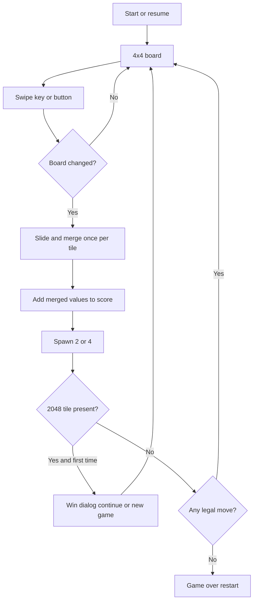

# Software Requirements Specification

## 2248

| | |
| --- | --- |
| Document title | Software Requirements Specification for 2248 |
| Version | 1.0 |
| Status | Approved for implementation |
| Date | 11 October 2026 |
| Product name | 2248 |
| Host project | Flutter application package `game_2248` |

This document follows the structure of IEEE Std 830 for a software requirements specification. Requirement identifiers in this document are the basis for a later implementation and for acceptance testing.

---

## 1. Introduction

### 1.1 Purpose

This Software Requirements Specification (SRS) defines the functional and non-functional requirements for **2248**, a single-player slide-and-merge puzzle. It is written for the people who will implement, test, and review the game inside the existing Flutter project.

The user-facing product name is 2248. The Flutter package name is `game_2248`. Application identifiers use `com.game2248.game2248`.

### 1.2 Scope

2248 is an offline puzzle. The player slides numbered tiles on a 4 by 4 board. Tiles of equal value that meet combine into one tile of double that value. The player wins by creating a tile with value 2048 and may continue playing after that win. The game ends when no legal move remains.

The software shall provide:

- a playable 4 by 4 board with classic merge rules
- a current score and a locally stored best score
- a new game, a win state that allows continued play, and a game-over state
- input by touch swipe, keyboard, and on-screen direction controls
- a layout that adapts from phone to desktop

The software shall not require an account, a network connection, or a remote service.

The following are outside the scope of version 1.0:

- undo
- online leaderboards
- user accounts
- advertising
- more than one color palette
- board sizes other than 4 by 4
- a winning tile value other than 2048

### 1.3 Definitions, acronyms, and abbreviations

| Term | Definition |
| --- | --- |
| Tile | A square on the board that holds a positive power of two, starting at 2. |
| Empty cell | A board position that holds no tile. |
| Board | The 4 by 4 grid of cells. Rows and columns are indexed from 0. |
| Move | One player action that requests a slide in a single direction: up, down, left, or right. |
| Leading edge | The side of the board toward which tiles travel. For a left move, column 0 is the leading edge. For an up move, row 0 is the leading edge. |
| Merge | The combination of two tiles of equal value into one tile whose value is their sum. |
| Valid move | A move that changes the board, either by sliding at least one tile into an empty cell or by merging at least one pair. |
| Spawn | Placement of one new tile on a randomly chosen empty cell after a valid move. |
| Score | The running total for the current game, increased by the value of each tile created by a merge. |
| Best score | The highest score stored on the device across games. |
| Win | The first time a tile of value 2048 exists on the board. |
| Game over | The state in which every cell is occupied and no two orthogonally adjacent tiles share a value. |
| SRS | Software Requirements Specification. |
| FR | Functional requirement. |
| NFR | Non-functional requirement. |
| UC | Use case. |

### 1.4 References

1. IEEE Std 830, IEEE Recommended Practice for Software Requirements Specifications.
2. Flutter documentation, https://docs.flutter.dev/.
3. `shared_preferences` package, already declared in `pubspec.yaml` of the host project. Version constraint at the time of this specification: `^2.5.6`.
4. Gabriele Cirulli, 2048 (2014). The rules in this specification match that puzzle: a 4 by 4 board, merge of equal values, a new tile after each valid move, and a win at 2048.

### 1.5 Overview

Section 2 describes the product, its users, and the constraints on the implementation. Section 3 states the external interfaces, functional requirements, use cases, and non-functional requirements. Section 4 lists acceptance criteria traced to those requirements.

---

## 2. Overall description

### 2.1 Product perspective

2248 is a self-contained Flutter application. It replaces the current counter demonstration in `lib/main.dart` when it is implemented. It does not depend on a backend.

Persistence is local. The current board, current score, win-acknowledged flag, and best score are stored on the device with `shared_preferences`.

The interface shall be built from shared design tokens:

- `lib/theme/app_colors.dart` for colors
- `lib/theme/app_theme.dart` for the Flutter `ThemeData`
- `lib/theme/app_text_styles.dart` for text styles

Those files do not exist yet. The implementation shall create them and shall reference them for colors, theme, and text styles used by the game screens.

### 2.2 Product functions

- Start a new game with two tiles on a clear board.
- Slide all tiles in one of four directions.
- Merge equal tiles according to the rules in section 3.2.
- Spawn a new tile after every valid move.
- Show the current score and the best score.
- Announce a win when a 2048 tile first appears, then allow continued play.
- Announce game over when no legal move remains, then allow a new game.
- Restore an in-progress game and the best score after the app is closed and opened again.

### 2.3 User characteristics

The player is a casual user on a phone, tablet, or desktop. No puzzle expertise is assumed. The player can read the on-screen score and can use either a finger, a mouse or trackpad, or a keyboard. The application is in English for version 1.0.

### 2.4 Constraints

- The host stack is Flutter with the Dart SDK constraint already set in `pubspec.yaml` (`sdk: ^3.11.5`).
- Local persistence uses `shared_preferences`. No other storage backend is required.
- The application runs without a network connection.
- The layout shall remain usable in portrait and landscape, from a narrow phone width through a desktop window.
- Colors, theme data, and text styles shall come from `app_colors.dart`, `app_theme.dart`, and `app_text_styles.dart`.
- The package name is `game_2248`. The window title, app bar title, and web title presented to the player shall read 2248.

### 2.5 Assumptions and dependencies

- The device can store a small set of preferences. If storage fails, the game remains playable for the current session and the best score may reset to the highest score observed in that session.
- Random cell selection and the 2-versus-4 spawn use a uniform pseudo-random source provided by the platform. Tests may inject a deterministic source.
- One player uses the app at a time on a given install. There is no multi-profile support.
- A tile value is a power of two from 2 upward. The implementation shall not cap the tile value at 2048. Continued play may produce 4096 and higher.

---

## 3. Specific requirements

### 3.1 External interface requirements

#### 3.1.1 User interfaces

The play screen shall show:

- the title 2248
- the current score
- the best score
- the 4 by 4 board, large enough to remain the focus of the screen
- a control to start a new game
- four on-screen direction controls: up, down, left, and right

Each tile shall display its numeric value. Empty cells shall be visibly empty. Distinct values shall use distinct fill colors from `app_colors.dart`, with text that stays readable on that fill (NFR-4).

A short slide animation shall accompany a valid move (NFR-3). The board state the player sees after the animation shall match the logical board after the move.

When the player first creates a 2048 tile, a dialog shall state that the player has won and shall offer:

- Continue, which dismisses the dialog and returns to the same board
- New game, which starts a new game as specified in FR-1

When no legal move remains, a dialog shall state that the game is over, shall show the final score, and shall offer New game.

#### 3.1.2 Hardware and software interfaces

| Input | Effect |
| --- | --- |
| Swipe up, down, left, or right on the board | Request a move in that direction |
| Arrow keys, or W A S D | Request the matching direction: W and Up, A and Left, S and Down, D and Right |
| On-screen direction control | Request that direction |
| New game control | Start a new game after confirmation if a game is in progress and is not over |
| Continue | Dismiss the win dialog and keep the current board |

A swipe that is mostly horizontal is a left or right move. A swipe that is mostly vertical is an up or down move. A gesture below the implementation's movement threshold shall be ignored and shall not change the board.

Keyboard input applies while the play screen is focused and no dialog is open. While a dialog is open, the dialog actions take priority over board moves.

#### 3.1.3 Communications interfaces

None. The application does not open network connections for gameplay, scores, or content.

### 3.2 Functional requirements

#### 3.2.1 Board and new game

**FR-1.** A new game shall clear the board, set the current score to 0, clear the win-acknowledged flag, place two tiles on distinct uniformly random empty cells, and persist the new state.

**FR-2.** Each spawned tile shall have value 2 with probability 0.9 and value 4 with probability 0.1, chosen independently for each spawn, including the two tiles placed by FR-1.

**FR-3.** The board shall contain exactly 16 cells in 4 rows and 4 columns. A cell holds at most one tile.

#### 3.2.2 Movement and merging

**FR-4.** A move shall slide every tile as far as possible toward the leading edge of the chosen direction. Order of resolution along each line shall start at the leading edge and proceed toward the trailing edge.

**FR-5.** Two tiles of equal value that would occupy the same cell, or that meet with no empty cell and no different-valued tile between them after the slide, shall merge into one tile whose value is the sum of the two values.

**FR-6.** A tile shall participate in at most one merge per move. A tile created by a merge shall not merge again during that same move.

**FR-7.** The score shall increase by the value of each tile created by a merge during that move. A slide that does not merge shall leave the score unchanged. Spawning a tile shall not change the score.

**FR-8.** If the board after sliding and merging is identical to the board before the move, the move is invalid. An invalid move shall not change the board, shall not change the score, and shall not spawn a tile.

**FR-9.** After a valid move, the game shall spawn exactly one tile on a uniformly random empty cell, using the value rule in FR-2.

Examples that acceptance tests shall cover:

- A line `[2, 2, 2, 2]` moved left becomes `[4, 4, empty, empty]` and adds 8 to the score. It does not become `[8, empty, empty, empty]`.
- A line `[2, 2, 2, empty]` moved left becomes `[4, 2, empty, empty]` and adds 4 to the score.
- A line `[4, 2, empty, 2]` moved right becomes `[empty, empty, 4, 4]` and adds 4 to the score.
- A line `[2, 2, 4, empty]` moved left becomes `[4, 4, empty, empty]` and adds 4 to the score. The new 4 does not merge with the existing 4 in the same move.

#### 3.2.3 Win and game over

**FR-10.** The game shall enter the win state when a tile of value 2048 is present and the win-acknowledged flag is clear. The win dialog in section 3.1.1 shall be shown. Creating a higher tile without having acknowledged 2048 still counts as this win.

**FR-11.** Continue shall set the win-acknowledged flag, dismiss the dialog, and leave the board and score unchanged. Further 2048 tiles, or higher tiles, shall not show the win dialog again during that game.

**FR-12.** After every valid move, including a move that caused a win, the game shall check for legal moves. A legal move exists when at least one empty cell remains, or when two orthogonally adjacent tiles have the same value. Diagonal neighbors do not form a legal move.

**FR-13.** If no legal move exists, the game shall enter game over and show the game-over dialog. Game over takes precedence over an unacknowledged win if both would apply after the same move: the player sees game over, and the score is final.

**FR-14.** New game from the game-over dialog, from the win dialog, or from the play-screen control shall execute FR-1. If the play-screen control is used while a game is in progress and is not over, the game shall ask the player to confirm. Confirming starts the new game. Cancelling leaves the current game unchanged.

#### 3.2.4 Persistence

**FR-15.** After each valid move, after a new game, and after the player acknowledges a win, the game shall persist the board, the current score, and the win-acknowledged flag.

**FR-16.** Whenever the current score exceeds the stored best score, the game shall update and persist the best score. The best score shall never decrease within an install, including when a new game starts.

**FR-17.** On launch, if a persisted game exists, the game shall restore that board, score, and win-acknowledged flag and shall restore the best score. If no persisted game exists, the game shall start a new game under FR-1 and shall show a best score of 0, or the persisted best score if one exists without a board.

### 3.3 Use cases

#### UC-1 Start a game

- **Actor:** Player
- **Precondition:** The app is open and no persisted in-progress game exists, or the player has confirmed New game.
- **Main flow:**
  1. The system clears the board and sets the score to 0.
  2. The system places two tiles under FR-1 and FR-2.
  3. The system shows the board, the score 0, and the best score.
- **Postcondition:** A game is in progress with exactly two tiles.

#### UC-2 Make a move

- **Actor:** Player
- **Precondition:** A game is in progress, no modal dialog is open, and the game is not over.
- **Main flow:**
  1. The player swipes, presses a direction key, or activates an on-screen direction control.
  2. The system slides and merges under FR-4 through FR-7.
  3. The board changed, so the system adds any merge values to the score, spawns one tile, persists state, and updates the best score if required.
  4. The system plays the slide animation and shows the new board.
- **Alternate flow:** The board would not change. The system ignores the input. No spawn, no score change, no animation that implies a move.
- **Postcondition:** The visible board matches the logical board. The score matches the sum of merged tile values since the start of the game.

#### UC-3 Win and continue

- **Actor:** Player
- **Precondition:** The win-acknowledged flag is clear.
- **Main flow:**
  1. A valid move creates a tile of value 2048 or greater.
  2. The system shows the win dialog.
  3. The player chooses Continue.
  4. The system sets the win-acknowledged flag, persists it, and returns to the same board.
- **Alternate flow:** The player chooses New game. The system executes UC-1.
- **Postcondition:** After Continue, play proceeds on the same board and the win dialog does not appear again for that game.

#### UC-4 Lose and restart

- **Actor:** Player
- **Precondition:** A valid move has just completed.
- **Main flow:**
  1. The system finds no empty cell and no orthogonally adjacent equal tiles.
  2. The system shows the game-over dialog with the final score.
  3. The player chooses New game.
  4. The system executes UC-1. The best score remains the stored best.
- **Postcondition:** A new game is in progress. The previous board is gone.

#### UC-5 Resume a saved game

- **Actor:** Player
- **Precondition:** A game was persisted and the app was fully closed.
- **Main flow:**
  1. The player opens the app.
  2. The system restores the board, current score, win-acknowledged flag, and best score.
  3. If the restored game is already over, the system shows the game-over dialog. If a 2048 tile is present and the win was not acknowledged, the system shows the win dialog.
- **Postcondition:** The player sees the same position they left.

### 3.4 Non-functional requirements

**NFR-1 Offline.** Gameplay, scoring, and persistence shall work with no network connection. The app shall not block play on a connectivity check.

**NFR-2 Response.** From the moment a move input is recognized, the logical board shall be updated within 100 milliseconds on a current mid-range phone. The animation may continue after that update.

**NFR-3 Animation.** A valid move shall animate tiles toward their destinations. The animation duration shall be between 80 and 200 milliseconds. An invalid move shall not play a board-changing animation.

**NFR-4 Readability.** Tile value text shall use a color from `app_colors.dart` whose contrast against the tile fill is at least 4.5 to 1 for the text sizes used. The score and best score shall use styles from `app_text_styles.dart`.

**NFR-5 Touch targets.** On-screen direction controls and the New game control shall have a hit target of at least 48 by 48 logical pixels.

**NFR-6 Responsive layout.** The board shall fit entirely on screen without scrolling in portrait and landscape. On widths below 600 logical pixels the board shall use nearly the full content width, with padding. On wider layouts the board shall be centered and shall not stretch to the full window width. Direction controls shall remain reachable without covering tiles.

**NFR-7 Integrity of rules.** Merge resolution, scoring, and spawn count shall be implemented as pure logic that can be tested without rendering widgets. Widget tests may cover the play screen separately.

**NFR-8 Session continuity.** Killing and reopening the app shall restore state under FR-17. A process restart during a move shall leave either the pre-move state or the post-move state, never a half-merged board.

### 3.5 Design constraints

- Implementation language and UI toolkit: Dart and Flutter.
- Theme source of truth: `lib/theme/app_colors.dart`, `lib/theme/app_theme.dart`, and `lib/theme/app_text_styles.dart`.
- Persistence: `shared_preferences`.
- Supported form factors: the platforms the host Flutter project already targets. The requirements in this document apply to each of them. Phone touch and desktop keyboard are both mandatory, not alternatives.
- The win condition is the tile value 2048. The product name 2248 does not change that value.

---

## 4. Acceptance criteria

Each item is a pass condition for version 1.0. The related requirement identifiers are in parentheses.

1. A new game shows a 4 by 4 board with exactly two tiles, each a 2 or a 4, and a score of 0 (FR-1, FR-2, FR-3, UC-1).
2. Over a large sample of spawns in a test harness, the share of 2s is consistent with probability 0.9 and the share of 4s with probability 0.1 (FR-2). The production UI is not required to expose this sample.
3. `[2, 2, 2, 2]` moved toward the leading edge becomes `[4, 4, empty, empty]` and the score increases by 8 (FR-4, FR-5, FR-6, FR-7).
4. `[2, 2, 2, empty]` moved left becomes `[4, 2, empty, empty]` and the score increases by 4 (FR-6, FR-7).
5. `[2, 2, 4, empty]` moved left becomes `[4, 4, empty, empty]` and the score increases by 4. The merged 4 does not combine with the existing 4 in that move (FR-6).
6. A move that would not change the board does not spawn a tile and does not change the score (FR-8).
7. A move that changes the board spawns exactly one tile on an empty cell (FR-9).
8. The first time a 2048 tile appears, the win dialog is shown. Continue returns to the same board. A later move does not show the win dialog again (FR-10, FR-11, UC-3).
9. Reaching 2048 does not by itself end the game. The player can keep merging (FR-11).
10. When the board is full and no orthogonal neighbors are equal, the game-over dialog is shown and New game starts a fresh board while keeping the best score (FR-12, FR-13, FR-14, UC-4).
11. If the current score passes the previous best, the displayed best score updates. After a new game and after the app is closed and reopened, that best score is still present (FR-16, FR-17, NFR-8).
12. Closing the app mid-game and opening it again restores the same board, score, and whether the win was already acknowledged (FR-15, FR-17, UC-5).
13. Swipe, arrow keys, W A S D, and the four on-screen direction controls each perform the matching move (section 3.1.2, UC-2).
14. The board is fully visible without scrolling in portrait and landscape on a narrow phone width and in a wide desktop window, and direction controls do not cover tiles (NFR-6).
15. With the device offline, the player can start a game, move, win or lose, and see a restored best score on the next launch (NFR-1, FR-16).

---

## Revision history

| Version | Date | Description |
| --- | --- | --- |
| 1.0 | 11 October 2026 | Initial IEEE 830 specification for 2248, a 4 by 4 slide-and-merge puzzle with a win at tile 2048. |
